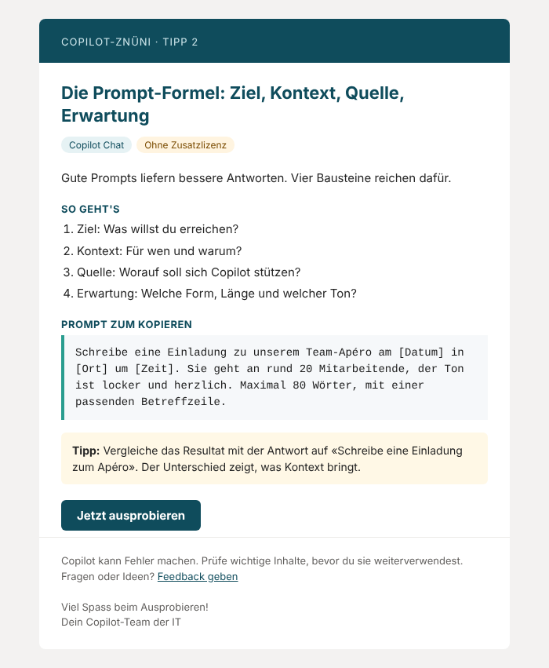

# Copilot-Znüni

**Jeden Arbeitstag ein kurzer Copilot-Tipp per Mail, automatisch versendet mit Power Automate und gesteuert über eine Excel-Tabelle.**

Copilot einzuführen ist das eine. Dass die Leute es danach auch nutzen, ist das andere. Das Copilot-Znüni setzt auf kleine Häppchen: ein Tipp pro Tag, in höchstens fünf Minuten ausprobiert, mit einem Prompt zum Kopieren und einem Link direkt in die passende App.

## Was drin ist

| Datei | Inhalt |
| --- | --- |
| [`flow/Copilot-Znueni_Flow.zip`](flow/Copilot-Znueni_Flow.zip) | Power-Automate-Flow als Import-Paket |
| [`vorlage/Copilot-Znueni_Tipps.xlsx`](vorlage/Copilot-Znueni_Tipps.xlsx) | 42 deutschsprachige Tipps (Stand Oktober 2026) und die Einstellungen |
| [`vorlage/mail-vorschau.html`](vorlage/mail-vorschau.html) | So sieht eine Tipp-Mail aus |
| [`docs/konzept.md`](docs/konzept.md) | Adoption-Konzept: Ablauf, Rollen, Erfolgsmessung |
| [`docs/installation.md`](docs/installation.md) | Schritt-für-Schritt-Einrichtung |
| [`docs/flow-aufbau.md`](docs/flow-aufbau.md) | Aufbau des Flows, Ausdrücke, manueller Nachbau |
| [`docs/kommunikation.md`](docs/kommunikation.md) | Vorlagen für Ankündigung, Start und Abschluss |
| [`flow/definition.json`](flow/definition.json) | Lesbare Flow-Definition |

## Funktionen

- **Versand nur Montag bis Freitag** um 08:45 Uhr (Zeitzone Zürich), direkt über den Zeitplan gesteuert
- **Reihenfolge = Reihenfolge in der Tabelle.** Versendet wird jeweils der oberste Tipp mit Status «Offen», danach wird er auf «Gesendet» gesetzt und das Datum eingetragen
- **Tipps überspringen** mit Status «Aus», **pausieren** über einen Schalter (z. B. Feiertage, Betriebsferien)
- **Zwei Zielgruppen:** Mit `NurChatTipps = Ja` werden nur Tipps versendet, die mit Copilot Chat ohne Zusatzlizenz funktionieren
- **Optionaler Absender**, z. B. eine geteilte Mailbox
- **Automatischer Stopp**, wenn alle Tipps versendet sind, mit Mail an den Admin
- **Fehlerbehandlung:** Bei einem Fehler erhält der Admin eine Mail mit dem betroffenen Schritt und einem Link zum Verlauf
- **Outlook-taugliches HTML** ohne externe Bilder, ohne Tracking, auch auf dem Smartphone lesbar
- **Nur Standard-Connectors** (Excel Online (Business), Office 365 Outlook). Es braucht keine Premium-Lizenz für Power Automate

## Schnellstart

1. Excel-Vorlage in eine SharePoint-Bibliothek der IT hochladen und im Blatt «Einstellungen» die gelben Felder ausfüllen.
2. In Power Automate unter **Meine Flows → Importieren → Paket importieren (Legacy)** die ZIP-Datei importieren und die beiden Verbindungen zuweisen.
3. In den vier Excel-Aktionen des Flows Speicherort, Datei und Tabelle auswählen.
4. Mit der eigenen Adresse als Empfänger testen, danach auf die Verteilerliste umstellen und `Pausiert` auf «Nein» setzen.

Die ausführliche Anleitung steht in [`docs/installation.md`](docs/installation.md).

## Tipps anpassen

Die Tipps sind bewusst allgemein gehalten. Am meisten bringt das Znüni, wenn ihr einige davon auf euren Alltag zuschneidet: eigene Dateien, Fachbegriffe, typische Aufgaben. Hinweise für Admins stehen in der Spalte «Hinweis» und werden nicht versendet.

> **Copilot ändert sich laufend.** Die Tipps entsprechen dem Stand Oktober 2026. Prüft Menünamen und Funktionen vor dem Versand im eigenen Tenant und deaktiviert Tipps zu Funktionen, die bei euch nicht freigegeben sind (z. B. Agents oder Bildgenerierung).

## Unterschiede zum Original «Copilot Yoga»

Das Projekt ist inspiriert von [sir-benniboy/copilotyoga](https://github.com/sir-benniboy/copilotyoga). Flow, Tipps und Vorlagen wurden neu erstellt.

| | Copilot Yoga (2024) | Copilot-Znüni |
| --- | --- | --- |
| Sprache | Englisch | Deutsch (Schweizer Schreibweise) |
| Tipps | 37, Stand 2024 | 42, Stand Oktober 2026, inkl. Agents, Researcher, Prompt Coach, geplante Prompts |
| Werktage | Berechnung über `WEEKDAY(TODAY())` in Excel. Mit dem Standardtyp ist Sonntag = 1, die Bedingung 1–5 trifft daher Sonntag bis Donnerstag | Zeitplan des Flows: Montag bis Freitag |
| Reihenfolge | Zähler in der Excel-Datei | Status pro Tipp (Offen, Gesendet, Aus) |
| Zielgruppen | eine | mit oder ohne Copilot-Lizenz |
| Pausieren, Ende, Fehler | – | Schalter, automatischer Stopp, Admin-Benachrichtigung |
| Mail | einfaches HTML mit externen Bildern | Outlook-taugliches Layout ohne externe Ressourcen |

## Voraussetzungen

- Microsoft 365 mit Power Automate (in den meisten M365-Plänen enthalten)
- Eine SharePoint-Bibliothek oder ein OneDrive für die Excel-Datei
- Für die Premium-Tipps: Microsoft 365 Copilot-Lizenzen bei den Empfängern

## Lizenz

[MIT](LICENSE). Microsoft, Microsoft 365, Copilot, Outlook, Teams, Excel, Word, PowerPoint, OneNote und Power Automate sind Marken von Microsoft. Dieses Projekt steht in keiner Verbindung zu Microsoft.
