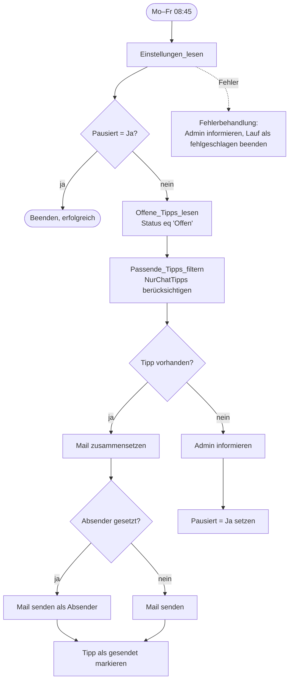

# Aufbau des Flows

Der Flow besteht aus einem Zeitplan-Trigger und zwei Bereichen (Scopes): **Ausfuehren** enthält die eigentliche Logik, **Fehlerbehandlung** läuft nur, wenn etwas schiefgeht.



## Trigger

**Wochentags_um_0845** (Wiederholung)
- Häufigkeit: 1 Woche
- Wochentage: Montag bis Freitag
- Stunden: 8, Minuten: 45
- Zeitzone: (UTC+01:00) Amsterdam, Berlin, Bern, Rom, Stockholm, Wien

## Bereich «Ausfuehren»

| Nr. | Aktion | Typ | Konfiguration |
| --- | --- | --- | --- |
| 1 | `Einstellungen_lesen` | Excel: Zeile abrufen | Tabelle `tblEinstellungen`, Schlüsselspalte `Id`, Schlüsselwert `1` |
| 2 | `Pausiert_pruefen` | Bedingung | `toLower(trim(coalesce(body('Einstellungen_lesen')?['Pausiert'],'')))` ist gleich `ja`. Bei Ja: `Beenden_weil_pausiert` (Beenden, Status «Erfolgreich») |
| 3 | `Offene_Tipps_lesen` | Excel: In einer Tabelle vorhandene Zeilen auflisten | Tabelle `tblTipps`, Filterabfrage `Status eq 'Offen'`, Anzahl 500 |
| 4 | `Passende_Tipps_filtern` | Array filtern | Von: `body('Offene_Tipps_lesen')?['value']`, Bedingung siehe unten |
| 5 | `Tipp_vorhanden` | Bedingung | `length(body('Passende_Tipps_filtern'))` ist grösser als `0` |

Bedingung von `Passende_Tipps_filtern` (im erweiterten Modus):

```
@or(not(equals(toLower(trim(coalesce(body('Einstellungen_lesen')?['NurChatTipps'],''))),'ja')),equals(toLower(trim(coalesce(item()?['Lizenz'],''))),'chat'))
```

### Zweig «Ja» von `Tipp_vorhanden`

| Aktion | Typ | Inhalt |
| --- | --- | --- |
| `Tipp` | Verfassen | `first(body('Passende_Tipps_filtern'))` |
| `Praefix` | Verfassen | Betreffpräfix oder «Copilot-Znüni» |
| `Anleitung_Block` … `Feedback_Block` | Verfassen | HTML-Bausteine, die nur erscheinen, wenn das Feld gefüllt ist |
| `Mail_HTML` | Verfassen | komplette Mail, siehe [`flow/mail-vorlage-ausdruck.txt`](../flow/mail-vorlage-ausdruck.txt) |
| `Betreff` | Verfassen | `Präfix: Titel` |
| `Absender_gesetzt` | Bedingung | `empty(...Absender...)` ist nicht `true`. Ja: `Mail_senden_als_Absender` mit Feld «Von (Senden als)». Nein: `Mail_senden` |
| `Tipp_als_gesendet_markieren` | Excel: Zeile aktualisieren | Tabelle `tblTipps`, Schlüsselspalte `Nr`, Status `Gesendet`, GesendetAm = heutiges Datum |

Beide Mail-Aktionen sind «E-Mail senden (V2)» von Office 365 Outlook mit An = `Empfaenger`, Betreff = `outputs('Betreff')`, Text = `outputs('Mail_HTML')`.

### Zweig «Nein» von `Tipp_vorhanden`

| Aktion | Typ | Inhalt |
| --- | --- | --- |
| `AdminMail_fuer_Ende_vorhanden` | Bedingung | Wenn `AdminMail` gefüllt: `Admin_ueber_Ende_informieren` (E-Mail senden) |
| `Automatisch_pausieren` | Excel: Zeile aktualisieren | Tabelle `tblEinstellungen`, Schlüssel `Id` = `1`, Pausiert = `Ja` |

## Bereich «Fehlerbehandlung»

Läuft nach «Ausfuehren», wenn dieses **fehlgeschlagen** ist oder ein **Timeout** hatte (Einstellungen → «Ausführen nach»).

| Aktion | Typ | Inhalt |
| --- | --- | --- |
| `Fehlgeschlagene_Schritte` | Array filtern | Von: `result('Ausfuehren')`, Bedingung: `equals(item()?['status'],'Failed')` |
| `AdminMail_fuer_Fehler_vorhanden` | Bedingung | Wenn `AdminMail` gefüllt: Mail mit Schrittname, Fehlermeldung und Link zum Lauf |
| `Lauf_als_fehlgeschlagen_beenden` | Beenden | Status «Fehlgeschlagen», damit der Flow-Besitzer zusätzlich die Standardbenachrichtigung von Power Automate erhält |

Link zum Lauf:

```
concat('https://make.powerautomate.com/environments/',workflow()?['tags']?['environmentName'],'/flows/',workflow()?['name'],'/runs/',workflow()?['run']?['name'])
```

## Ausdrücke der Verfassen-Aktionen

Ein Wert, der mit `@` beginnt, ist ein reiner Ausdruck. Ohne führendes `@` ist es Text mit eingebetteten Ausdrücken `@{...}`. Beim manuellen Nachbau gibst du den Teil nach dem `@` im Ausdruckseditor ein.

### Anleitung_Block

```
@if(empty(trim(coalesce(outputs('Tipp')?['Anleitung'],''))),'',concat('<tr><td style="padding:12px 28px 0 28px;"><p style="margin:0 0 6px 0;font-size:13px;font-weight:bold;text-transform:uppercase;letter-spacing:0.5px;color:#0f4c5c;">So geht&#39;s</p><ol style="margin:0;padding-left:20px;font-size:15px;line-height:1.55;"><li style="margin-bottom:4px;">',replace(replace(trim(coalesce(outputs('Tipp')?['Anleitung'],'')),decodeUriComponent('%0D'),''),decodeUriComponent('%0A'),'</li><li style="margin-bottom:4px;">'),'</li></ol></td></tr>'))
```

### Prompt_Block

```
@if(empty(trim(coalesce(outputs('Tipp')?['Prompt'],''))),'',concat('<tr><td style="padding:16px 28px 0 28px;"><p style="margin:0 0 6px 0;font-size:13px;font-weight:bold;text-transform:uppercase;letter-spacing:0.5px;color:#0f4c5c;">Prompt zum Kopieren</p><table role="presentation" width="100%" cellpadding="0" cellspacing="0" border="0"><tr><td bgcolor="#f6f8fa" style="background-color:#f6f8fa;border-left:4px solid #2a9d8f;padding:12px 14px;font-family:Consolas,Courier New,monospace;font-size:14px;line-height:1.5;color:#1b1b1b;">',replace(replace(trim(coalesce(outputs('Tipp')?['Prompt'],'')),decodeUriComponent('%0D'),''),decodeUriComponent('%0A'),'<br>'),'</td></tr></table></td></tr>'))
```

### Tipp_Block

```
@if(empty(trim(coalesce(outputs('Tipp')?['Tipp'],''))),'',concat('<tr><td style="padding:16px 28px 0 28px;"><table role="presentation" width="100%" cellpadding="0" cellspacing="0" border="0"><tr><td bgcolor="#fff8e6" style="background-color:#fff8e6;border-radius:6px;padding:12px 14px;font-size:14px;line-height:1.5;"><strong>Tipp:</strong> ',trim(coalesce(outputs('Tipp')?['Tipp'],'')),'</td></tr></table></td></tr>'))
```

### Link_Block

```
@if(empty(trim(coalesce(outputs('Tipp')?['Link'],''))),'',concat('<tr><td style="padding:20px 28px 8px 28px;"><a href="',trim(coalesce(outputs('Tipp')?['Link'],'')),'" style="display:inline-block;background-color:#0f4c5c;color:#ffffff;text-decoration:none;font-size:15px;font-weight:bold;padding:10px 20px;border-radius:6px;">Jetzt ausprobieren</a></td></tr>'))
```

### Feedback_Block

```
@if(empty(trim(coalesce(body('Einstellungen_lesen')?['FeedbackLink'],''))),'',concat('<br>Fragen oder Ideen? <a href="',trim(coalesce(body('Einstellungen_lesen')?['FeedbackLink'],'')),'" style="color:#0f4c5c;">Feedback geben</a>'))
```

### Praefix

```
@if(empty(trim(coalesce(body('Einstellungen_lesen')?['Betreffpraefix'],''))),'Copilot-Znüni',trim(coalesce(body('Einstellungen_lesen')?['Betreffpraefix'],'')))
```

### Betreff

```
@{outputs('Praefix')}: @{trim(coalesce(outputs('Tipp')?['Titel'],''))}
```


## Manueller Nachbau

Falls der Paketimport in deiner Umgebung nicht funktioniert:

1. Neuen **geplanten Cloud-Flow** erstellen (Montag bis Freitag, 08:45).
2. Zwei Aktionen **Bereich** anlegen: `Ausfuehren` und `Fehlerbehandlung`. Bei `Fehlerbehandlung` unter «Ausführen nach» nur «ist fehlgeschlagen» und «hat Timeout» aktivieren.
3. Die Aktionen gemäss den Tabellen oben anlegen und **genau so benennen** wie angegeben. Die Ausdrücke verweisen auf diese Namen.
4. Für `Mail_HTML` den Inhalt von [`flow/mail-vorlage-ausdruck.txt`](../flow/mail-vorlage-ausdruck.txt) in das Eingabefeld einfügen. Im klassischen Designer werden die `@{...}`-Teile beim Speichern als Ausdrücke erkannt. Prüfe im Testlauf, dass die Platzhalter ersetzt werden.

## Anpassungen

- **Uhrzeit oder Tage:** im Trigger.
- **Design der Mail:** Farben und Texte in `Mail_HTML` und den Block-Aktionen. Das Layout verwendet Tabellen und Inline-Styles, damit es auch im klassischen Outlook korrekt dargestellt wird.
- **Teams statt Mail:** Mail-Aktionen durch «Nachricht in einem Chat oder Kanal posten» ersetzen. Das HTML ist dann zu vereinfachen, da Teams nicht alle Styles unterstützt.
